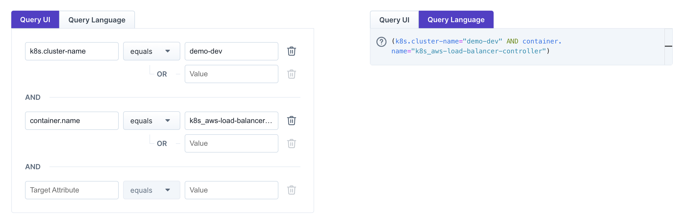
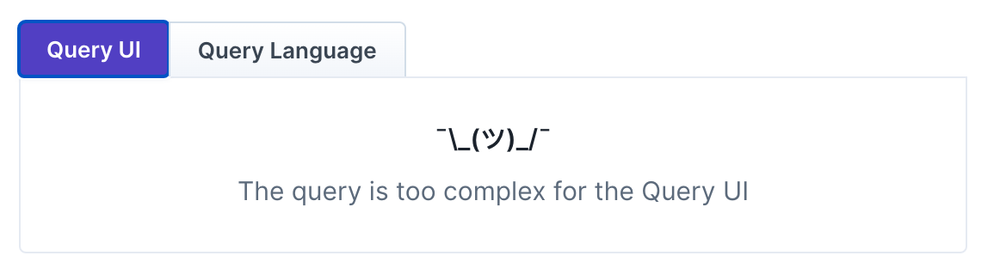

# Query Language

## What is the Query Language?

A query selects targets from Steadybit's [discovery data](../discovery/) by their attributes. You use queries wherever targets need to be narrowed down: in an [environment's scope](/install-and-configure/manage-environments/#define-environment-scope), a service's target scope, an experiment's [blast radius](/use-steadybit/experiments/design.md#basic-elements), and the target explorer.

You can write a query in two ways:

* **Query UI** (default): pick keys and values from dropdowns. All conditions are combined with `AND`, which covers simple queries like "cluster `prod`, namespace `shop`".
* **Query Language**: write the query as text. It supports everything the Query UI does, plus `OR`, `NOT`, parentheses, partial and case-insensitive matches, lists of values, presence checks, aggregations, and comments.

The rest of this page is about the Query Language.

## How to switch between the Query UI and the Query Language

<figure><figcaption><p>The same query can be expressed with the Query UI on the left and the Query Language on the right</p></figcaption></figure>

Both editors work on the same query. Switch to the Query Language tab, and the query you built in the Query UI is translated into text, ready to extend. Like the Query UI, the editor offers auto-completion for keys and values.

The Query UI can only show queries that combine conditions with `AND`. A query like `(a="b" AND d="e") OR f="g"` can only be edited with the Query Language, and the interface tells you when that's the case.

<figure><figcaption><p>Complex queries can only be edited in the Query language editor.</p></figcaption></figure>

## Query Examples

### Key-value comparison

Keys and values can be compared using `=`, `!=`, `~`, `!~`, `=*`, `!=*`, `~*`, `!~*`, `IN ()` and `NOT IN ()`

```
// Simple equals check to get all targets of Kubernetes Cluster 'prod'
k8s.cluster-name="prod"

// Get all Daemonsets/Deployments/Statefulsets
target.type IN ("com.steadybit.extension_kubernetes.kubernetes-daemonset", "com.steadybit.extension_kubernetes.kubernetes-deployment", "com.steadybit.extension_kubernetes.kubernetes-statefulset")  
```

```
// Not equals check to get all targets not running in the Kubernetes Cluster 'prod'
k8s.cluster-name!="prod"

// Get all targets that are not a Daemonset/Deployment/Statefulset
target.type NOT IN ("com.steadybit.extension_kubernetes.kubernetes-daemonset", "com.steadybit.extension_kubernetes.kubernetes-deployment", "com.steadybit.extension_kubernetes.kubernetes-statefulset")  
```

```
// Get all targets with a container name that contains "hot-deals"
k8s.container.name~"hot-deals"
```
```
// Query for all container targets whose maintainer does not contain Jane
container.label.maintainer!~"Jane"
```

```
// Simple equals ignore case check to get all targets of Kubernetes Cluster 'PrOd' ignore casing
k8s.cluster-name=*"PrOd"
```
```
// Not equals ignore case check to get all targets not running in the Kubernetes Cluster 'PrOd' ignore casing
k8s.cluster-name!=*"PrOd"
```
```
// Get all targets with a container name that contains "Hot-DeAls" ignore casing
k8s.container.name~*"Hot-DeAls"
```
```
// Query for all container targets whose maintainer does not contain "jAne" ignore casing
container.label.maintainer!~*"jAne"
```

You can also check for the presence or absence of a certain key using `IS PRESENT` and `IS NOT PRESENT`.

```
// Cluster-name is set, so getting all targets running in a Kubernetes cluster
k8s.cluster-name IS PRESENT
```
```
// Kubernetes label service-tier isn't set on a target
k8s.label.service-tier IS NOT PRESENT
```

### Using variables and placeholders

You can use an experiment [variable](../../use-steadybit/experiments/variables.md) (`{{...}}`) or a template placeholder (`[[...]]`) as a value in a query. Markers may be written with or without quotes:

```
// Reference a variable as the value
k8s.deployment={{deployment}}

// Equivalent, quoted form
k8s.deployment="{{deployment}}"
```

When a variable holds several values (a [list of fixed values](../../use-steadybit/experiments/variables.md#list-of-fixed-values) or a multi-value [dynamic value](../../use-steadybit/experiments/variables.md#dynamic-value)), using it inside `IN (...)` matches _any_ of its values:

```
// Matches every deployment the variable resolves to
k8s.deployment IN ({{deployment}})
```


A `=` (or `!=`) comparison against a multi-value variable also works: it matches when the attribute equals **any** of the values (and `!=` when it equals **none**), i.e. it is equivalent to `IN (...)` (`NOT IN (...)`). The Query UI displays it in the `IN (...)` form.



### Aggregations

To aggregate a key's value, you can use the `COUNT` function to check for the number of distinct values with numeric operators like `<`,`<=`,`=`,`>=` and `>`.

```
// Only find targets running in at least two AWS availability zones   
COUNT(aws.zone) >= 2
```
```
// Only find targets running just a single pod replica   
COUNT(k8s.pod.name) = 1
```

### Expression Concatenation

Simple expressions can be chained with AND & OR.

```
// Get all targets of Kubernetes cluster "prod" or "staging"
k8s.cluster-name="prod" OR k8s.cluster-name="staging"
```
```
// Get all targets of Kubernetes cluster "prod" running on the host "ip-1-2-3-4"
k8s.cluster-name="prod" AND host.hostname="ip-1-2-3-4"
```

### Expression Negation

You can negate a specific key-value expression using NOT.

```
// Matches all, but not prod
NOT k8s.cluster-name="prod"
```

### Parenthesis

Expression blocks can be encapsulated using parentheses.

```
(k8s.cluster-name="prod" OR k8s.cluster-name="staging") AND aws.zone="eu-central-1b"
```

### Quoting Special Characters

Keys containing special characters like `:` and `/` need to be quoted to work properly.

```
// Quoting keys with special characters is necessary
"label.aws:ec2launchtemplate/version"="some value"
```

### Comments

A query can explain itself. Anything from `//` to the end of the line is a comment: it is ignored
when the query is evaluated, and it is stored with the query, so the reason a target was excluded
stays next to the exclusion.

A comment can stand on its own line:

```
// The canary tier is deployed continuously, so it is expected to be unstable.
k8s.cluster-name="prod" AND NOT k8s.label.tier="canary"
```

or follow a query on the same line:

```
k8s.cluster-name="prod" // only production
```

Comments work everywhere queries do — environment scopes, service target scopes, experiment blast
radii, the target explorer and the API.

Two things to be aware of:

- A `//` inside a quoted value is part of the value, not a comment, so URLs keep working:
  `"label.url"="https://example.com"`.
- A query made up of nothing but comments is treated as an empty query. A query only ever *narrows*
  what its scope already contains, so commenting one out stops the narrowing rather than emptying
  the selection: an experiment's blast radius then covers every target of that action's target type
  in the experiment's environment, and a service's target scope every target in its environment. The
  one to watch is an [environment's own scope](/install-and-configure/manage-environments/#define-your-own-environment),
  where the query *is* the boundary — commenting that out covers every target in the tenant.
