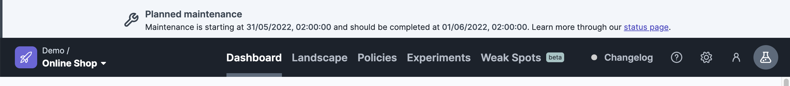
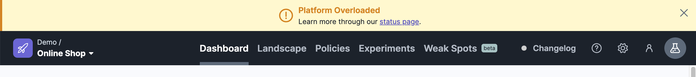

# Maintenance & Incident Support

During the operation of the on-premise Steadybit platform, you may run into situations where your users need to be informed about incidents and planned maintenance. To inform these users, you can tell the Steadybit platform about incidents and maintenance windows. Once done, the platform can

* show banners in the user interface indicating the specific situation,
* require explicit confirmation when executing experiments via the user interface, and
* optionally disable experiment runs entirely during an ongoing incident.

This feature is available in versions > 1.0.2 of the Steadybit platform.

## Learning about Platform Activity

You can use the following metrics to learn whether maintenance on the Steadybit platform would be affecting any users:

* `platform.experiments.executing` is exposed by the Steadybit platform as a Prometheus metric. It represents the number of currently executing experiments.

## Admin API Endpoints

The maintenance and incident API endpoints are only reachable through the admin port `9090` on the platform Kubernetes deployment workload. This port is not exposed to users by default, and you should only use it for administrative purposes.

Reading the maintenance or incident configuration (`GET`) needs no authentication. Setting or clearing it (`POST`, `DELETE`) only works from inside the platform pod and needs the secret the platform writes to `/opt/steadybit/platform/data/admin-secret` on every start, sent in the `X-Steadybit-Admin-Secret` header. Requests without it are rejected with 403.

One option to reach this port from your local machine is a port forward. Read the secret from the same pod you forward to, as the following snippet shows, since every pod has its own secret:

```bash
POD=$(kubectl get pod -n steadybit-platform -l app.kubernetes.io/name=steadybit-platform -o name | head -n 1)
kubectl port-forward -n steadybit-platform "$POD" 9090 &
SECRET=$(kubectl exec -n steadybit-platform "$POD" -- cat /opt/steadybit/platform/data/admin-secret)
```

The secret changes when the pod restarts, so read it again after a restart.

### Maintenance

To configure a maintenance window, you can use the API endpoints under path `/actuator/systemstatusmaintenance`. You can retrieve the maintenance configuration via HTTP `GET` or clear it via HTTP `DELETE` (with the secret header). The following example shows how you could leverage HTTP `POST` to configure a maintenance window.

```bash
curl -X POST \
  -H "Content-Type: application/json" \
  -H "X-Steadybit-Admin-Secret: $SECRET" \
  http://localhost:9090/actuator/systemstatusmaintenance -d '
{
  "title": "Planned maintenance",
  "message": "We need to perform maintenance on the platform",
  "statusPage": "https://status.example.com",
  "start": "2024-06-07T00:00:00Z",
  "end": "2024-06-08T00:00:00Z"
}
'
```



### Incidents

You can use incidents to inform users of service disruption. In contrast to scheduled maintenance, an incident is never scheduled and has varying severity. To configure an incident, you can use the API endpoints under path `/actuator/systemstatusincident`. You can retrieve the incident configuration via HTTP `GET` or clear it via HTTP `DELETE` (with the secret header). The following example shows how you could leverage HTTP `POST` to configure an incident.

```bash
curl -X POST \
  -H "Content-Type: application/json" \
  -H "X-Steadybit-Admin-Secret: $SECRET" \
  http://localhost:9090/actuator/systemstatusincident -d '
{
  "title": "Platform Overloaded",
  "message": "We are experiencing high load on the platform",
  "statusPage": "https://status.example.com",
  "allowExperimentExecution": true,
  "severity": "DEGRADED_PERFORMANCE"
}
'
```



The following severities are supported by the API. The user interface will adapt its banner style according to the chosen incident severity.

* `UNDER_MAINTENANCE`
* `DEGRADED_PERFORMANCE`
* `PARTIAL_OUTAGE`
* `MAJOR_OUTAGE`
