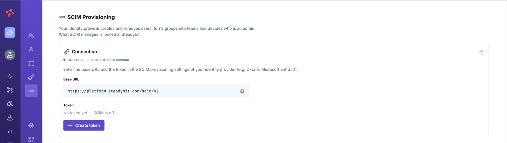
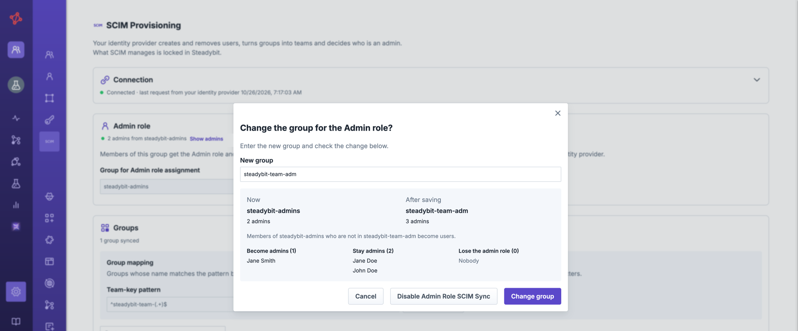
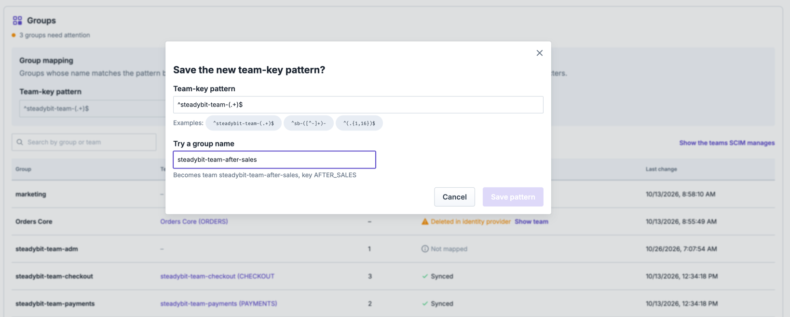

# SCIM Provisioning

With SCIM (System for Cross-domain Identity Management), your identity provider manages who has access to Steadybit. It creates users when you assign them, keeps their name and email up to date, and removes their access when you unassign or deactivate them. Groups become Steadybit teams, and an admin group decides who gets the `admin` role.

Steadybit implements SCIM 2.0 (RFC 7643 and RFC 7644) and is tested with **Okta** and **Microsoft Entra ID**. Other identity providers that speak SCIM 2.0 work the same way.

## Requirements

- **License:** SCIM is a license feature. Contact your Steadybit account team to have it added to your license.
- **Single sign-on on SaaS:** on Steadybit SaaS, your users must sign in through your identity provider. Steadybit sets up this connection for your tenant; ask your Steadybit contact. Steadybit accepts a SCIM token only after an admin has signed in through that connection once.
- **Reachable from your identity provider (on-prem):** your identity provider must reach `https://<your platform host>/scim/v2` over HTTPS. Cloud identity providers such as Okta and Entra call it from the internet; if your installation is not reachable from there, use your identity provider's on-prem provisioning agent, e.g. the Microsoft Entra provisioning agent.

## Set Up SCIM

### Step 1 - Create the SCIM Token

Go to **Settings → SCIM** in Steadybit, create the SCIM token, and copy it right away; Steadybit shows it only once. There is one token per tenant. It belongs to the tenant, not to you, so it keeps working if your own account is removed. The page also shows the SCIM base URL:

- SaaS: `https://platform.steadybit.com/scim/v2`
- On-prem: `https://<your platform host>/scim/v2`


Creating the token switches SCIM on. From then on, your identity provider manages the users it provisions, and some actions in Steadybit are locked for them — see [How Steadybit Behaves](#how-steadybit-behaves). Groups have no effect until you map them in step 3.


### Step 2 - Connect Your Identity Provider

#### Okta

1. Use the Steadybit application you sign in with (or create an app integration with SCIM provisioning). On its **Provisioning** tab, enable SCIM provisioning.
2. Under **Integration**, set:
   - SCIM connector base URL: the SCIM base URL from step 1
   - Unique identifier field for users: `userName`
   - Supported provisioning actions: push new users, push profile updates, and push groups
   - Authentication mode: **HTTP Header**, with the SCIM token as the bearer token
3. Under **To App**, enable **Create Users**, **Update User Attributes**, and **Deactivate Users**.
4. Assign the people who should have access to the application.
5. On the **Push Groups** tab, push the groups that should become teams, and your admin group.

#### Microsoft Entra ID

Entra offers SCIM provisioning only for enterprise applications created as a non-gallery application: **Enterprise applications → New application → Create your own application → Integrate any other application you don't find in the gallery**. You can use the same application for single sign-on.

1. On the application, open **Provisioning** and set the provisioning mode to **Automatic**.
2. Under **Admin Credentials**, set:
   - Tenant URL: the SCIM base URL from step 1 followed by `?aadOptscim062020`, e.g. `https://platform.steadybit.com/scim/v2?aadOptscim062020` — the flag makes Entra send standard-compliant requests
   - Secret token: the SCIM token
   - Then select **Test Connection**.
3. Under **Mappings**, keep **Provision Microsoft Entra ID Users** (`userPrincipalName` → `userName`, `mail` → the work email) and enable **Provision Microsoft Entra ID Groups**. Entra sends no email for users whose `mail` attribute is empty.
4. Under **Settings**, set the scope to **Sync only assigned users and groups**.
5. Under **Users and groups**, assign the people and the groups that should have access. Assigning groups requires Microsoft Entra ID P1 or higher.
6. Start provisioning.

Entra provisions in cycles of about 40 minutes. To see a change in Steadybit right away, use **Provision on demand** on the application's provisioning page.

In Entra, members of a group that is assigned to the application count as assigned themselves. To take someone's access away, remove their direct assignment **and** their membership in every assigned group.


To provision only some of the users who can sign in, add a **scoping filter** to the user mapping, e.g. on `userPrincipalName`. Assigned users outside the filter can still sign in, but are not provisioned.


### Step 3 - Map Groups to Teams and Roles

Back on **Settings → SCIM**, decide what your identity provider's groups mean. Until you save these settings, every group your identity provider sends is stored without effect: it creates no team, and roles stay as you manage them in Steadybit.

| Setting                         | Effect                                                                                                                                                                                                  |
|---------------------------------|---------------------------------------------------------------------------------------------------------------------------------------------------------------------------------------------------------|
| Group for Admin role assignment | Members of this group are admins and members of the Administrators team (`ADM`); every other provisioned user is a `user`. Leave it empty to manage roles in Steadybit.                                 |
| Team-key pattern                | A regular expression for group names. A group whose name matches becomes a team; the first capture group is the team key, e.g. `^steadybit-team-(.+)$` turns `steadybit-team-payments` into `PAYMENTS`. |

As your identity provider has already sent its groups, the page previews what saving would change: which teams the groups would create or take over, and whether you would lose your own admin role. It does not save a group for Admin role assignment that would leave your tenant without an admin. Groups that match neither setting stay without effect.

How the team key is derived from a group name: Steadybit takes the pattern's first capture group, turns every run of characters other than letters, digits, and `_` into a single `_`, upper-cases the result, and cuts it to 16 characters. With `^steadybit-team-(.+)$`, the group `steadybit-team-data.platform` becomes the team `DATA_PLATFORM`. A group whose key would be `ADM`, or that does not match the pattern, becomes no team. Without a pattern, no group becomes a team.

## What Is Supported

| Area                 | Supported                                                                                                                                 |
|----------------------|-------------------------------------------------------------------------------------------------------------------------------------------|
| Resources            | `Users` and `Groups`, plus the discovery endpoints `ServiceProviderConfig`, `ResourceTypes`, and `Schemas`                                |
| Operations           | Create (`POST`), read (`GET`), replace (`PUT`), update (`PATCH`, including the request shapes Okta and Entra send), and delete (`DELETE`) |
| Filters              | Users by `userName`, `externalId`, or `emails.value`; groups by `displayName` or `externalId` (`eq`, combined with `and`)                 |
| User attributes      | User name, display name and name parts, email, photo, and active state                                                                    |
| Authentication       | The tenant's SCIM token as a bearer token                                                                                                 |
| Not supported        | Bulk operations, sorting, ETags, and password changes                                                                                     |

## How Steadybit Behaves

### Users

| In your identity provider                                              | In Steadybit                                                                                                                                                                                                                    |
|------------------------------------------------------------------------|---------------------------------------------------------------------------------------------------------------------------------------------------------------------------------------------------------------------------------|
| A person is assigned                                                   | The user is created as a `user` of your tenant. No welcome email is sent; the user signs in through single sign-on.                                                                                                             |
| A person is assigned who already has a Steadybit account               | The existing account is taken over, matched by user name and otherwise by email. No second account is created.                                                                                                                  |
| Name, email, or photo change                                           | The profile is updated, as long as the user belongs to no other Steadybit tenant. Users cannot change their own name in Steadybit.                                                                                              |
| A person is unassigned or deactivated                                  | The user loses access to your tenant right away: they leave all its teams, their access tokens for the tenant are deleted, and they are signed out. A user who belongs to no other tenant is deleted.                           |
| The person is assigned again                                           | The user comes back, with the teams of their groups and the role from the admin group.                                                                                                                                          |
| Someone signs in through single sign-on without being provisioned      | They see a page saying they have no access to your tenant, instead of getting access.                                                                                                                                           |

### Teams

| In your identity provider                                | In Steadybit                                                                                                                                                                                                                        |
|----------------------------------------------------------|-------------------------------------------------------------------------------------------------------------------------------------------------------------------------------------------------------------------------------------|
| A group matching the team-key pattern is pushed          | A team with the derived key is created, managed by SCIM. If a team with that key exists, SCIM takes it over: earlier members who are in the group become SCIM members, the others stay as members you manage in Steadybit.          |
| Members are added to or removed from the group           | They are added to or removed from the team.                                                                                                                                                                                         |
| The group is renamed                                     | The team is renamed; its key never changes.                                                                                                                                                                                         |
| The group is deleted or no longer pushed                 | The group's members leave the team, including earlier members who were in the group too; the other earlier members stay. The team stays and is managed in Steadybit again. The SCIM page marks it as no longer backed by a group.   |
| A group matches neither setting                          | Nothing happens. The SCIM page lists it as not mapped.                                                                                                                                                                              |
| A group would map to the Administrators team (`ADM`)     | It is not mapped. Only the admin group fills the Administrators team.                                                                                                                                                               |

In Steadybit, a team managed by SCIM cannot be renamed or deleted, its SCIM members cannot be removed, and nobody can be added to it by hand — add people to the group in your identity provider instead. Members the team had before SCIM took it over stay as members you manage in Steadybit: SCIM leaves them alone, and the SCIM page shows how many there are. Admins can still change the team's allowed actions, environments, and logo, and the role of its members, e.g. make someone an owner.

Nothing on a team is lost: when SCIM takes a team over or its group is deleted, the team keeps its experiments, schedules, and settings. When someone leaves, the experiments they created stay with their team.

Changing the team-key pattern maps only groups that are not mapped yet. A group that already backs a team keeps it, even if its name no longer matches, so a typo in the pattern never takes people out of their teams.

### Roles

- **Without an admin group,** SCIM does not manage roles. Provisioned users start as `user`, and admins change roles on the Users page.
- **With an admin group,** members of the group are `admin`, and every other provisioned user is `user`. Their roles cannot be changed in Steadybit. Removing the admin group from the settings hands the roles back: everyone keeps the role they have, and you manage it in Steadybit again.
- **Losing the admin role takes effect at once:** the user is signed out, and their admin access tokens are deleted.
- **Your identity provider decides.** Steadybit applies role changes exactly as your identity provider sends them, even when they take the admin role from your tenant's last admin. Keep at least one person in your admin group.
- **Saving the settings never leaves your tenant without an admin.** If a new group for Admin role assignment would take the admin role from every admin of your tenant, synced or not, Steadybit refuses to save it. You can make yourself a `user` this way, as long as another admin remains.

### Single Sign-On and SCIM

- **SCIM decides who has access, single sign-on how people sign in.** While SCIM is on, signing in no longer adds anyone to your tenant or changes their teams. Teams that sign-ins created from a groups claim stay as they are, unless a SCIM group maps to the same team key and takes them over; the members the sign-ins added then stay as members you manage in Steadybit.
- **A sign-in has to find its provisioned user.** Steadybit looks the user up by user name first and by email second. Provision the user name people sign in with — the default mappings do (Okta: `userName`, Entra: `userPrincipalName`) — or make sure the email your identity provider provisions is exactly the one the sign-in sends, including upper and lower case. A sign-in that finds no provisioned user gets an account without access to your tenant.

### Users and Teams Steadybit Manages

Users you invited before SCIM, and users your identity provider does not provision, stay as they are: you can still change their role or remove them. While SCIM is on, inviting new users is turned off, and users provisioned by SCIM can only be removed in your identity provider. The Users and Teams pages can be filtered by what manages an entry, and the SCIM page lists members that SCIM does not manage.

### Switch SCIM Off

**Disable SCIM Provisioning** on the SCIM page deletes the SCIM token and switches SCIM off. Every team SCIM manages is handed back to Steadybit with its current members, and everyone keeps their current role. Your identity provider can no longer reach Steadybit. Creating a token again switches SCIM back on: the groups take their teams over again, and roles follow the admin group again.
