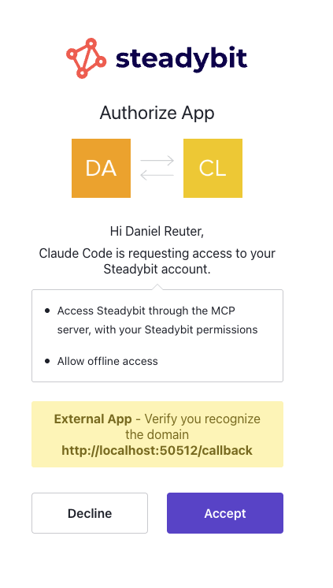

# Remote MCP Server

Steadybit ships a hosted [Model Context Protocol](https://modelcontextprotocol.io) (MCP) server, so you can connect AI agents such as Claude Code, Claude Desktop, or GitHub Copilot in VS Code directly to your Steadybit tenant. Once connected, the assistant can explore your environments, targets, actions, services, experiments, and execution results — and, with the right permissions, help you design, save, and run experiments — so you can understand your system, reason about resilience, and act on it.

Every tool runs with the permissions of the credential you connect with — the same team permissions, environment allowances, and license that apply in the UI and public API — so the assistant can only do what that credential is allowed to do. With OAuth the credential is your own user account; an access token acts with the token's own scope (a single team, all teams, or an admin token's tenant-wide access).


The MCP server is a licensed feature. If the endpoints below reject your requests, ask your Steadybit administrator to confirm that MCP is enabled for your tenant. The AI-assisted tools (experiment design, suggestions, and run analysis) additionally require the Steadybit AI feature.


## Capabilities

The server groups its tools into a few areas:

**Explore & analyze**

* Environments, teams, targets (with counts and statistics), and actions
* Services and their Service Risk breakdown
* Experiments and experiment templates
* Executions (runs): per-step results, notably failed targets, logs, and the metrics collected during a run
* Reliability advice for your targets
* Reporting trends — experiment executions and Service Risk over time

**Design & author**

* Turn a natural-language description into an experiment design, or get experiment suggestions for an environment or service
* Create a new experiment, update an existing one, or create one from a template

**Run**

* Start an experiment execution, or cancel a running one


Running an experiment injects **real faults** into your infrastructure. Treat the run tools as destructive — a well-behaved client will confirm with you before starting a run, and execution requires the same team and environment permissions as running from the UI or public API.


## Authentication

There are two ways to authenticate an MCP client. Pick whichever fits your client and workflow — both connect to the same server and expose the same capabilities.

| Method           | Endpoint                             | Best for                                    |
| ---------------- | ------------------------------------ | ------------------------------------------- |
| **Access token** | `https://platform.steadybit.com/mcp` | Any MCP client; scripted or headless setups |
| **OAuth**        | `https://platform.steadybit.com/mcp` | Clients with an interactive browser login   |

### Method 1 — Access token

The simplest option, supported by every MCP client that can send an HTTP header. Create an [access token](api/api.md#access-tokens) in the UI under **Settings → API Access Tokens**, then pass it in the `Authorization` header when adding the server. The token already carries its tenant, so you connect to the plain `/mcp` endpoint.

For [Claude Code](https://docs.claude.com/en/docs/claude-code):

```bash
claude mcp add --transport http steadybit \
  https://platform.steadybit.com/mcp \
  --header "Authorization: Bearer <your-access-token>"
```

The same works for any other MCP client — point it at `https://platform.steadybit.com/mcp` and configure an `Authorization: Bearer <your-access-token>` header.

### Method 2 — OAuth

With OAuth, the client opens your browser, you log in to Steadybit through your identity provider, and you approve access on a consent screen — no token to copy or store. Point the client at `https://platform.steadybit.com/mcp`; your tenant is taken from your Steadybit membership.

For [Claude Code](https://docs.claude.com/en/docs/claude-code):

```bash
claude mcp add --transport http steadybit \
  https://platform.steadybit.com/mcp
```

If you belong to more than one tenant, connect to the one you want: `https://platform.steadybit.com/mcp/<tenant>`, replacing `<tenant>` with your tenant key. On the plain `/mcp` the connection cannot tell which tenant you mean: it connects, but offers only a setup tool that lists your tenant keys, and the assistant passes that on when you ask it anything.

If you added Steadybit from Claude's connector directory and belong to several tenants, add a custom connector with your tenant's URL instead — the directory connector's URL cannot be changed.

On first use the client opens a browser window where you sign in and confirm the connection:

<figure><figcaption></figcaption></figure>

Access is granted based on your existing Steadybit membership: the assistant acts as you, within the same tenant and permissions you already have.

#### New to Steadybit

You don't need a Steadybit account before you connect. On the sign-in page, choose **Sign up** and create an account with your email address (you confirm it with a code we send you) or with a social login. If your account doesn't belong to a Steadybit tenant yet, Steadybit then offers a free 30-day trial: choose **Create trial & connect**, and the client connects to your new tenant, which comes with sample data to explore. Choose **Cancel** to stop without a trial — the client then reports that access was denied.


With enterprise SSO, use an [access token](#method-1-access-token), or ask Steadybit to enable OAuth for your identity provider.


#### Supported clients

The OAuth path works with MCP clients that Steadybit has registered with its identity provider:

* **Claude Code**
* **Claude Desktop / Web**
* **VS Code** — including **GitHub Copilot** chat and agent mode, which connect through VS Code's built-in MCP client

Other clients that require Dynamic Client Registration (for example Cursor, Windsurf, the Codex CLI, and the GitHub Copilot CLI) are not supported on the OAuth path today. Use the [access token](#method-1-access-token) method with those clients instead.

### OAuth on a Self-Hosted Platform

On a self-hosted platform, the MCP server can use OAuth through the same OpenID Connect identity provider that your users sign in with. Your identity provider is the authorization server. The MCP client opens a browser, the user signs in there, and the client sends the resulting access token to the platform. Steadybit stores no MCP credentials, and no traffic goes through Steadybit or a third party: the client talks directly to your identity provider and your platform.

The platform trusts the access token only to identify the user. Tenant, role and teams come from the user's existing Steadybit account, exactly as for a sign-in to the UI. So every user must have signed in to the platform at least once before connecting an MCP client.

#### Requirements

* Platform version `2.8.12` or later. For older versions, see [Okta on older platform versions](#okta-on-older-platform-versions).
* Users sign in to the platform with OpenID Connect (`STEADYBIT_AUTH_PROVIDER=oauth2`).
* `platform.publicWebUrl` is set. The MCP endpoint is `<publicWebUrl>/mcp`, and this exact URL is the audience the access tokens must be issued for.
* Your license includes the MCP server.

Your identity provider must issue access tokens that are:

* **JWTs from the same issuer as the platform's sign-in** (`STEADYBIT_AUTH_OAUTH2_ISSUER_URI`). The platform verifies the MCP tokens with the same keys and issuer as the sign-in.
* **Issued for the audience** `<publicWebUrl>/mcp`.
* **Carrying a claim that identifies the user** the same way the sign-in does. By default this is the claim set in `STEADYBIT_AUTH_OAUTH2_USER_NAME_ATTRIBUTE` (default `sub`). If your identity provider puts the user's identifier into a different claim of the access token, set `STEADYBIT_MCP_AUTH_OAUTH_USER_NAME_ATTRIBUTE` to that claim.

#### Example: Okta

1. **Authorization server.** Under **Security → API**, use a custom authorization server (`default` or a dedicated one). Okta's org authorization server cannot be used, because it only issues tokens for Okta's own APIs. The platform's sign-in must use the **same** authorization server: set `STEADYBIT_AUTH_OAUTH2_ISSUER_URI` to its issuer, e.g. `https://<your-org>.okta.com/oauth2/<authorization-server-id>`.
2. On that authorization server:
   * **Audience:** `https://<your-platform>/mcp`
   * **Scopes:** add a scope `read`. `offline_access` already exists.
   * **Access policy:** a policy for the platform's sign-in app and the MCP app below, with a rule that allows the **Authorization Code** grant. A short access token lifetime (5–15 minutes) means a user disabled in Okta loses MCP access quickly; refresh tokens keep the session going in the meantime.
3. **App for the MCP clients.** Create an **OIDC – Native Application**:
   * **Grant types:** Authorization Code and Refresh Token
   * **Client authentication:** none, with PKCE required
   * **Sign-in redirect URI:** `http://localhost:<port>/callback`, with a fixed port of your choice, e.g. `8765`
   * **Assignments:** the users or groups that may connect
4. **Platform configuration.** Okta puts the user's login into the `sub` claim of access tokens, while the sign-in identifies users by their Okta user id, which access tokens carry in `uid`. Add to your Helm values:

```yaml
platform:
  publicWebUrl: https://<your-platform>
  env:
    - name: STEADYBIT_MCP_AUTH_OAUTH_ENABLED
      value: "true"
    - name: STEADYBIT_MCP_AUTH_OAUTH_USER_NAME_ATTRIBUTE
      value: uid
```

5. **Connect Claude Code** with the client id of the app from step 3 and the port of its redirect URI:

```bash
claude mcp add --transport http steadybit \
  --client-id <client-id-of-the-native-app> --callback-port 8765 \
  https://<your-platform>/mcp
```

Then run `/mcp` in Claude Code, select `steadybit` and choose **Authenticate**. To roll this out to all developers at once, distribute the same server entry, including the client id, through Claude Code's managed MCP configuration.


Okta cannot register MCP clients automatically: its dynamic client registration requires an admin token. That is why every client needs the client id of the app from step 3, and why clients that only support dynamic client registration (for example Cursor, Windsurf, the Codex CLI and the GitHub Copilot CLI) can't use OAuth with Okta. Use an [access token](#method-1-access-token) with those clients.


#### Organization-Wide Connectors in Claude

Connectors that an organization adds for all its members in Claude (claude.ai Team and Enterprise) are called from Anthropic's cloud, not from the user's computer. To use one, both `https://<your-platform>/mcp` and your identity provider's token endpoint must be reachable from the internet. A platform that is only reachable inside your network can't be used as such a connector. Claude Code, in contrast, connects from the developer's computer, so it works with a platform inside your network.

#### Okta on Older Platform Versions

Platforms older than `2.8.12` lack `STEADYBIT_MCP_AUTH_OAUTH_USER_NAME_ATTRIBUTE`. From `2.8.1` on, they can identify users by a claim that Okta can put into both tokens:

1. Set `STEADYBIT_AUTH_OAUTH2_USER_NAME_ATTRIBUTE=preferred_username` on the platform. Okta's ID token carries the user's login in that claim.
2. On the authorization server, add a claim `preferred_username` to the **access token** with the value `user.login`.
3. Have each user sign in to the platform once after the change, before they connect an MCP client. Existing users are matched by their email address, so they keep their accounts, teams and roles.

Depending on the version, also:

* **Before `2.8.7`:** set `STEADYBIT_MCP_ENABLED=true`. The MCP server is on by default only from `2.8.7` on.
* **Before `2.8.6`:** connect clients to `https://<your-platform>/mcp/<tenant-key>` instead of `https://<your-platform>/mcp`.
