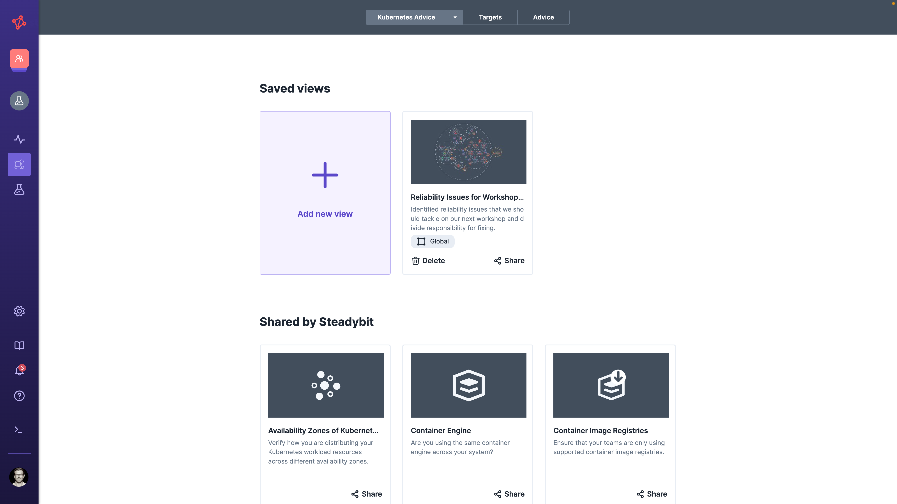

# Explorer

Steadybit's Explorer shows you an overview of all targets discovered by extensions. It is perfect for checking whether Steadybit has discovered all your infrastructure components, and for deciding where to continue your Chaos Engineering journey. You can either view the targets in a table or explore them in the Landscape.

* [Landscape](landscape.md)
* [Targets Table](targets.md)
* [Advice](advice.md)

## One Scope for All Three

The three tabs are three ways of looking at the same set of targets, so they share the two things that decide which targets those are:

* the **environment**, the maximum set of targets you can explore, and
* the **filter**, a [query](../../concepts/query-language/) narrowing that set to what you are interested in.

Set either one on any tab and the other two follow, so narrowing down in the Landscape and then reading the result as a table does not mean searching for the same thing twice. Grouping, sizing, and coloring only change how the Landscape draws its bubbles, so those controls appear on that tab alone.

When nothing matches, the Explorer tells you which of these is the reason — the environment is empty, the filter excludes everything, or, in the Landscape, the grouping hides it — and offers the control that fixes it.

## Saved Views

A view is a scope you want to come back to: an environment, a filter, and — for the Landscape — its grouping, sizing, and coloring. Save one and it is shared with your team automatically; you can also share it with a deep link to that particular view.

A view belongs to the whole Explorer rather than to one tab. It opens on the tab you saved it from, and switching tabs keeps the view you are in, so a view saved on the Targets table opens as a table for everyone who follows your link.

Changing anything in a view — the filter, the name, the grouping — reveals **Save** and a discard button in the header. Nothing is saved until you press Save, and leaving the Explorer never interrupts you to ask: exploring is what the Explorer is for. Use **Save as duplicate** to keep your changes as a second view and leave the original as it is.

In addition, Steadybit shares some predefined views that help you get started. They depend on the targets actually discovered, showing a Kubernetes map only when at least one Kubernetes cluster is discovered. These cannot be changed in place — changing one offers **Save as new view**, which saves a copy to your team.

