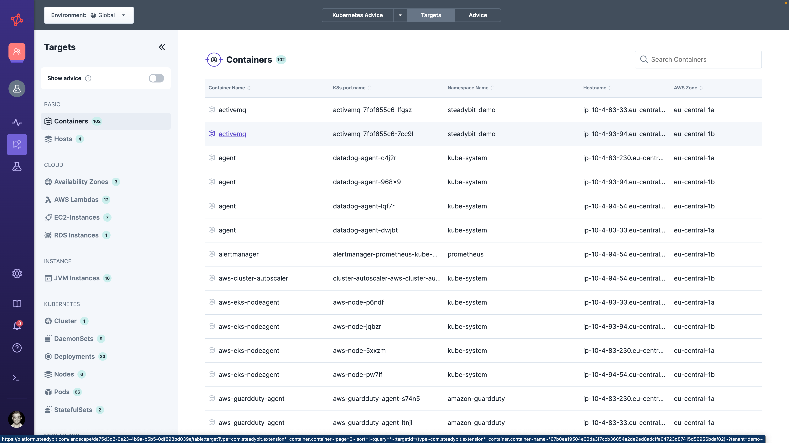
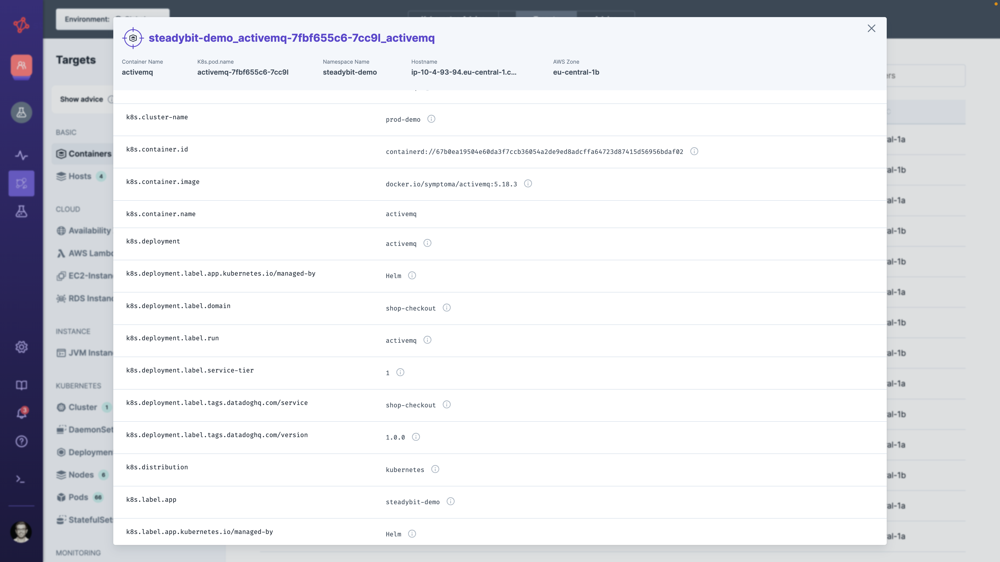
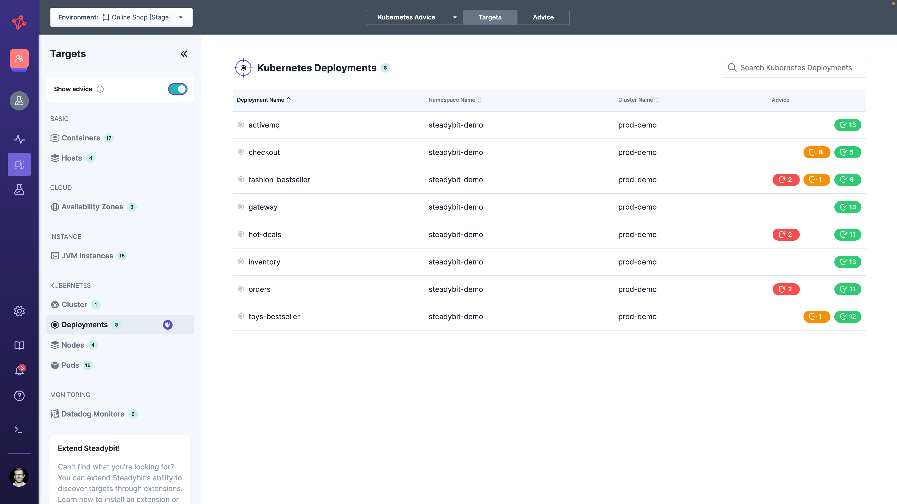

# Targets

## Table View

The explorer target table gives you an overview of all targets to check, e.g., for completeness of targets or whether a newly installed extension discovers the appropriate target type. You can always see the full details of a target by clicking on it. Depending on your team's permissions, you can select the Global environment to see all discovered targets, or choose a specific environment to list only the targets you have access to.

The environment and the filter are [shared with the other two tabs](README.md#one-scope-for-all-three), so a filter you set in the Landscape narrows this table as well, and can be kept in a [saved view](README.md#saved-views). A target type the filter leaves nothing of stays in the list, grayed out and showing `0`; opening it tells you that the filter is why, and offers to clear it.

 

## Advice

Once you activate the 'Show Advice' in the sidebar, the general advice icon indicates target types that have advice. You can see the advice per target in the table and details about each advice in the target details.

Learn more about [advice](advice.md) in the corresponding section.
